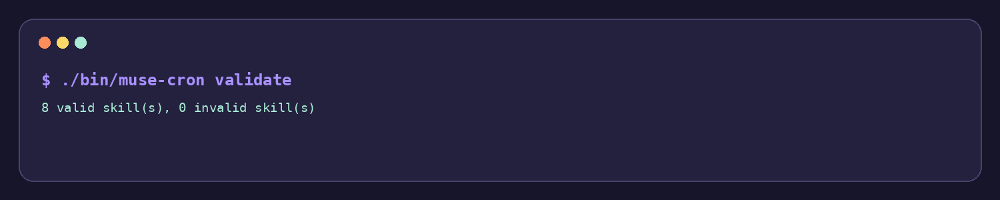
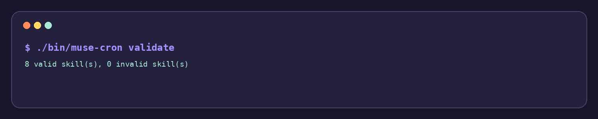
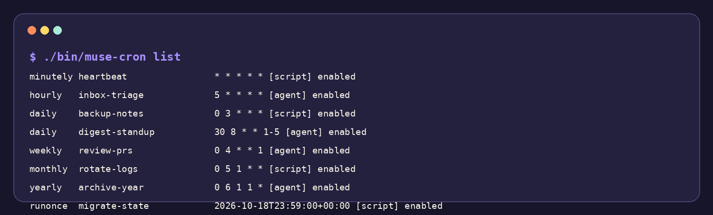
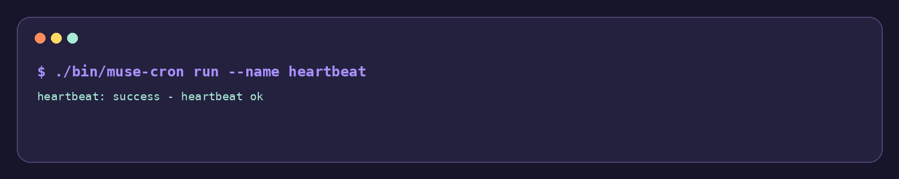

# muse-cron

A small, dependency-free cron worker for running Muse AI skills and shell scripts on a predictable schedule.

> Put a skill in a frequency bucket. Validate it before bedtime. Let a tiny worker handle the locks, retries, timeouts, logs, and state.

**Current state:** working prototype / starter implementation. The repository includes a functional Python CLI, sample skills, tests, documentation, and a local-only visual landing page. There is currently no published package, CI workflow, or live demo URL configured.

## Why this exists

Scheduled automation gets messy quickly. A few shell commands turn into scattered cron entries, unclear ownership, overlapping runs, silent failures, and no obvious place to see what happened last night.

`muse-cron` gives those jobs a small, inspectable home. Skills live under `cron.d/` in buckets such as `minutely/`, `daily/`, and `runonce/`. Each skill declares its mode, timeout, retry policy, schedule, and instructions in one Markdown file.

The project is intentionally different in a few ways:

- **Filesystem-first:** the directory tree is the inventory; there is no database or service to configure.
- **Script and agent friendly:** a skill can run a sibling shell script or send its Markdown body to an agent command.
- **Safe starter defaults:** malformed skills are reported, locks prevent overlapping runs, and execution state is recorded.
- **Boring to install:** it uses Python's standard library and does not require a package manager.

## See it work

There is no hosted demo yet. The fastest real demo is the CLI in this repository:



```bash
./bin/muse-cron validate
./bin/muse-cron list
./bin/muse-cron run --name heartbeat
```

Expected output from the current sample tree:

```text
8 valid skill(s), 0 invalid skill(s)
minutely heartbeat                * * * * * [script] enabled
hourly   inbox-triage             5 * * * * [agent] enabled
...
heartbeat: success - heartbeat ok
```

The most direct example is [`cron.d/minutely/heartbeat.skill.md`](cron.d/minutely/heartbeat.skill.md), which runs [`cron.d/minutely/heartbeat/check.sh`](cron.d/minutely/heartbeat/check.sh).

### Real CLI screenshots

These images are generated from the working commands above, not mockups:

| Validation | Skill inventory | Script execution |
|---|---|---|
|  |  |  |

## Quick start

### Requirements

- Python 3.9 or newer
- A POSIX-like shell for the included `.sh` examples
- No third-party Python packages

### Run the sample worker

From the repository root:

```bash
# Validate every discovered skill.
./bin/muse-cron validate

# List bucket, name, schedule, mode, and enabled state.
./bin/muse-cron list

# Run the known-good sample script.
./bin/muse-cron run --name heartbeat
```

Run the tests with:

```bash
python3 -m unittest discover -s tests -v
```

Print host-cron entries without modifying your crontab:

```bash
./bin/muse-cron install --print
```

`install` only prints entries. It does not install or edit a user's crontab.

## How a skill works

A skill is a `*.skill.md` file inside one of the `cron.d/` buckets. The frontmatter describes execution; the Markdown body is the prompt or human-readable task description.

```markdown
---
name: backup-notes
schedule: "0 3 * * *"
timeout: 300
retries: 2
idempotent: true
enabled: true
mode: script
script: run.sh
hooks: none
---
# Backup notes

Run the backup script and report a one-line summary.
```

The repository includes examples for:

- A script skill: [`backup-notes`](cron.d/daily/backup-notes.skill.md)
- An agent skill: [`inbox-triage`](cron.d/hourly/inbox-triage.skill.md)
- A one-shot skill: [`migrate-state`](cron.d/runonce/2026-10-18-migrate-state.skill.md)
- A companion script: [`heartbeat/check.sh`](cron.d/minutely/heartbeat/check.sh)

Read the complete schema in [`docs/skill-format.md`](docs/skill-format.md) and the cadence table in [`docs/scheduling.md`](docs/scheduling.md).

## Agent mode

Script-mode skills execute their configured sibling script. Agent-mode skills send the Markdown body to the command named by `MUSE_AGENT_COMMAND`.

The command receives the prompt on standard input. It may use these placeholders:

- `{model}` — the skill's `model`, or `default`
- `{max_tokens}` — the skill's `max_tokens`, or `2000`
- `{skill}` — the skill name

Example shape:

```bash
export MUSE_AGENT_COMMAND='your-agent-runner --model {model} --max-tokens {max_tokens} --skill {skill}'
./bin/muse-cron run --name digest-standup
```

If `MUSE_AGENT_COMMAND` is not set, agent skills perform a logged dry run rather than calling an external model.

## Scheduling model

The frequency directory communicates intent and the frontmatter `schedule` provides the cron expression. The current sample defaults are:

| Bucket | Default expression | Intended cadence |
|---|---:|---|
| `secondly` | `* * * * * *` | gated / host-dependent |
| `minutely` | `* * * * *` | every minute |
| `hourly` | `5 * * * *` | five minutes past the hour |
| `daily` | `0 3 * * *` | 03:00 UTC |
| `weekly` | `0 4 * * 1` | Monday at 04:00 UTC |
| `monthly` | `0 5 1 * *` | first day at 05:00 UTC |
| `yearly` | `0 6 1 1 *` | January 1 at 06:00 UTC |
| `runonce` | — | controlled by ISO-8601 `run_at` |

Important implementation note: `muse-cron install --print` emits host-cron lines, while the current `run --due` check is intentionally lightweight. Non-runonce skills are treated as eligible when enabled; cron-expression matching is delegated to the host scheduler. `secondly/` is present as a reserved bucket but is not enabled by default.

## What happens during a run

1. The loader discovers `*.skill.md` files in the supported buckets.
2. Frontmatter is parsed and required fields are validated.
3. A per-skill lock is created under `run/locks/` to avoid overlap.
4. The script or agent command runs with its configured timeout and retry count.
5. The latest result is written to `state/last_run.json`.
6. A readable monthly log is appended under `logs/<skill>/`.
7. A successful `runonce` skill with `on_success: archive` moves into `cron.d/_archive/`.

The source modules are deliberately small and separated by responsibility:

```text
lib/frontmatter.py  parse skill metadata
lib/loader.py       discover and validate skills
lib/scheduler.py    eligibility and bucket expressions
lib/executor.py     locks, retries, timeouts, and logging
lib/muse.py         agent-command adapter
lib/quarantine.py   archive/quarantine helpers
```

## Local visual landing page

The repository also contains a colorful, static project page at [`web/index.html`](web/index.html), with the favicon and promotional assets in [`web/assets/`](web/assets/). It is not deployed from this repository.

Preview it locally from the repository root:

```bash
python3 -m http.server 8000
```

Then open <http://localhost:8000/web/>. The page includes the configured Discord widget, so the embedded community panel requires network access and may be unavailable in an offline environment.

## Repository layout

```text
muse-cron/
├── bin/                 CLI entry points
├── config.toml          global defaults and bucket expressions
├── cron.d/              scheduled skill definitions and examples
├── docs/                skill format and scheduling notes
├── lib/                 loader, scheduler, executor, and adapters
├── logs/                per-skill execution logs
├── prompts/             shared system and prompt fragments
├── run/locks/           ephemeral overlap-prevention locks
├── state/               last-run and run-once state
├── tests/               standard-library unit tests
└── web/                 local-only landing page and assets
```

## Limitations and honest edges

- There is no live deployment, package release, or CI workflow configured yet.
- The current test suite focuses on discovery and validation; it does not yet cover every executor failure mode.
- `config.toml` documents global defaults, while the current CLI keeps configuration parsing intentionally minimal.
- The host scheduler remains responsible for exact cron-expression timing when using generated crontab lines.
- `secondly/` requires an external scheduler that understands six-field expressions and is gated in the project configuration.

## Contributing

Small, focused changes are welcome. A good contribution should include a fixture or test when it changes parsing, scheduling, execution, or quarantine behavior.

```bash
python3 -m unittest discover -s tests -v
./bin/muse-cron validate
```

Please keep skills deterministic, idempotent where possible, explicit about side effects, and safe to retry.

## License

No `LICENSE` file is currently included in this repository. Add the project’s intended license before publishing or accepting external contributions.
